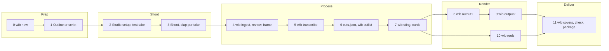

# WIB podcast building pipeline

Turns the raw recordings of an episode of **What I Built (WIB)**, a podcast for AI builders, into finished files ready to post: the clean long-form master, the YouTube long form with effects and subtitles, Instagram reels with covers, and the YouTube thumbnail, title and chapters. Free tools only, runs on a MacBook Air.

It works for solo episodes (screen plus a face bubble, like Episode 01) and for conversations with a guest in the same room (one camera on both, each person on their own mic, like Episode 02).

The pipeline runs like a build: every stage is one `wib` command driven by one settings file per episode (`episode.json`), writes its results to disk, and has a quality gate. Claude Code or Codex can run any stage, stop when usage runs out, and the other picks it up from the files at the same quality.

## The pipeline



| Stage | Command | Produces |
|---|---|---|
| 0 Setup | `wib new` | Episode folder and `episode.json` |
| 4 Ingest | `wib ingest`, `wib review`, `wib frame` | Every file synced by the clap, level and pace notes, framing stills |
| 5 Transcribe | `wib transcribe` | Word-timed transcript per take, each word labelled with who said it |
| 6 Cut | `wib cutlist` | The edit, from the agent's cut plan |
| 7 Motion | `wib sting`, `wib cards` | 15 s intro sting (16:9 and 9:16), 3 s chapter cards |
| 8 Output1 | `wib output1` | Clean 4K master at −14 LUFS and a DaVinci Resolve timeline |
| 9 Output2 | `wib output2` | 4K YouTube cut with cards, gentle zooms, music, and `.srt` |
| 10 Reels | `wib reels` | 1080×1920 reels with face, kinetic captions and B-roll |
| 11 Deliver | `wib covers`, `wib check`, `wib package` | Covers, thumbnail, quality report, title, description with chapters, previews |

In a conversation, the camera switches between the wide shot and each person's close-up from who is talking (measured from the two mics), and the two mics are auto-mixed so room bleed doesn't double anyone's voice.

## Files

- [WORKFLOW.md](WORKFLOW.md): the full spec. Every stage's steps, rules, approved values and gates, plus the same-room recording setup.
- [AGENTS.md](AGENTS.md): how Claude Code and Codex run, hand off and resume a stage.
- [prompts/](prompts/): what the agent follows to write the cut plan, zooms and reel picks.
- [episodes/_template/](episodes/_template/): `episode.json` templates (solo and conversation) and example plans.
- [docs/architecture.html](docs/architecture.html): the architecture diagram.
- [docs/setup.md](docs/setup.md): installing everything on the Mac.

## Quick start

```bash
uv sync --extra mac                       # once
uv run wib new wib-002 --number 02        # then fill in episodes/wib-002/episode.json
# copy the recordings into episodes/wib-002/raw/, then:
uv run wib ingest wib-002 && uv run wib transcribe wib-002
claude                                    # or: codex
> Edit episode wib-002 end to end following WORKFLOW.md.
```

`uv run pytest` runs the whole pipeline on generated two-person test footage (about 4 minutes).
